# Nexus Explorer

Nexus Explorer is a modern desktop file manager and developer workstation for Windows, built with Tauri v2, Rust, and React 19. It combines low-overhead native filesystem integration with an extensible user interface designed for speed, keyboard navigation, and developer workflows.

---

## Architecture

Nexus Explorer is architected in two primary layers:
1. **Core Engine (`nexus-core`)**: A pure Rust library providing native Win32/NTFS/ReFS filesystem operations, content hashing, cryptographic vaults, and background I/O workers.
2. **Desktop Application (`src-tauri` + `src`)**: A Tauri v2 desktop application pairing native asynchronous command dispatching with a React 19 + TypeScript frontend.

```mermaid
graph TD
    classDef ui fill:#1e1e2e,stroke:#89b4fa,stroke-width:2px,color:#cdd6f4;
    classDef ipc fill:#181825,stroke:#f5c2e7,stroke-width:2px,color:#cdd6f4;
    classDef core fill:#11111b,stroke:#a6e3a1,stroke-width:2px,color:#cdd6f4;
    classDef win fill:#313244,stroke:#fab387,stroke-width:1px,color:#cdd6f4;

    subgraph Frontend ["Frontend (React 19 + TypeScript)"]
        UI_List["File List & Virtual Grid"]:::ui
        UI_Miller["Miller Columns View"]:::ui
        UI_FAYT["Find-As-You-Type (FAYT) Search"]:::ui
        UI_Previews["Media & Code Previews"]:::ui
        UI_Modals["Tools & Modals (Vault, Clean, DLP, VDFS)"]:::ui
    end

    subgraph Boundary ["IPC Transport"]
        TAURI_IPC["Tauri v2 Type-Safe IPC & Channel Streaming"]:::ipc
        CLI["Standalone CLI (nexus-cli)"]:::ipc
    end

    subgraph Engine ["Core Engine (nexus-core)"]
        VDFS["VDFS & BLAKE3 Content-Addressed Index"]:::core
        COW["ReFS CoW Extent Cloning (FSCTL)"]:::core
        USN["NTFS USN Journal Stream Reader"]:::core
        VSS["Volume Shadow Copy (VSS) Snapshots"]:::core
        DLP["Sensitive Pattern & Secret Scanner"]:::core
        SHRED["Multi-Pass Secure File Shredder"]:::core
        VAULT["AES-256-GCM Authenticated Vaults"]:::core
        WEBDROP["Local LAN WebDrop Portal"]:::core
        JANITOR["Cache & Build Artifact Cleaner"]:::core
        MOUNTER["Virtual Drive Mounter (subst)"]:::core
    end

    subgraph OS ["Operating System (Windows Kernel)"]
        WIN_IO["Win32 Storage & IOCTL APIs"]:::win
        WIN_DEV["Dev Drive & ReFS / NTFS Volumes"]:::win
    end

    Frontend --> Boundary
    Boundary --> Engine
    Engine --> OS
```



---

## Features

### Directory Navigation & Views
* **Multiple Layout Modes**: Toggle between Details List, Virtual Grid, and cascading Miller Columns (`Ctrl+1`, `Ctrl+2`, `Ctrl+3`).
* **Multi-Level Tree-in-List Expansion**: Expand folders inline recursively to arbitrary depth levels within the details list to inspect nested directory hierarchies without losing scroll position.
* **Interactive Breadcrumbs**: Breadcrumb separator chevrons display subfolder popover menus for instant child/sibling navigation; trailing history dropdown provides one-click access to recent and visited locations.
* **Search & Switch Open Tabs**: Total Commander–style tab list switcher (`Ctrl+Shift+A`) with real-time fuzzy search by title, path, or color group.
* **Go to Folder Dialog**: Direct path navigation (`Ctrl+G`) with debounced path validation and quick destination chips (Home, Desktop, Documents, Downloads, Drives, WSL).
* **Configurable Dynamic Columns**: Toggle visible columns (Date modified, Date created, Type, Size, Extension) with right-click header menu and layout persistence.
* **Automatic Folder Sizing**: Asynchronous background sizing queues calculate folder capacities upon navigation without blocking UI interaction.
* **Dual-Pane Workspaces**: Split directory views horizontally or vertically with synchronized navigation (`Ctrl+Shift+D`) and dual-pane directory content comparison with automatic difference selection (`Ctrl+Shift+E`).

### Search, Selection & Navigation
* **Orthodox Selection Tools**: Total Commander–style Select by Pattern (`Ctrl+Shift+S` / `+`) with wildcards, extensions, regex, and live match counters; and Invert Selection (`Ctrl+Shift+I` / `*`).
* **Find-As-You-Type (FAYT)**:
  * `'` (single quote): In-view filtering.
  * `+` (plus): Indexed fast search across mounted drives.
  * `>` (greater-than): Inline shell command execution.
  * `]` (bracket): Bookmark fast-jump.
* **Multi-Format Archive Engine**: Pack and extract archives natively (pure Rust ZIP) or via 7-Zip (`.7z`, `.tar.gz`, `.tar`) with configurable compression levels (Store to Ultra).
* **Vim Navigation**: Full modal navigation support (`h`, `j`, `k`, `l`, `gg`, `G`, `y`, `d`, `p`).
* **Gamepad Support**: Navigation through standard Gamepad API controllers for handheld Windows devices.

### Native Windows Filesystem Tools
* **ReFS Block Cloning**: Zero-copy file and directory duplication on supported ReFS volumes via Win32 `FSCTL_DUPLICATE_EXTENTS_TO_FILE`.
* **USN Journal Monitoring**: Real-time volume change streaming using NTFS `FSCTL_READ_USN_JOURNAL`.
* **Volume Shadow Copy (VSS)**: Inspect previous shadow copies and restore specific versions of files.
* **Process Lock Detection**: Identify and release file locks using the Windows Restart Manager API (`RstrtMgr.dll`).
* **Virtual Drive Mounter**: Map directories and archives to drive letters via `subst` redirection.

### Security & Maintenance
* **AES-256-GCM Vaults**: Encrypt sensitive files and directories into standalone authenticated `.nxvault` containers.
* **Secure Deletion**: Multi-pass cryptographically randomized data overwriting compliant with DoD 5220.22-M standards.
* **Secret & DLP Scanner**: Scan files and directories for uncommitted API tokens (GitHub, OpenAI, Anthropic, AWS), private keys, and credential patterns.
* **Artifact Cleaner**: Scan and purge temporary build directories (`node_modules`, `target`, `.venv`, `bin`, `obj`) to reclaim storage space.
* **LAN WebDrop**: Built-in HTTP portal on local Wi-Fi allowing direct file transfers between mobile devices and PC without cloud dependencies.

---

## Standalone CLI (`nexus-cli`)

Nexus Explorer includes a standalone headless CLI built from `crates/nexus-cli`:

```bash
# Content-addressable index status
nexus-cli vdfs status
nexus-cli vdfs index C:\Projects --node-name workstation

# Local Wi-Fi transfer portal
nexus-cli webdrop document.pdf image.png --port 52493

# Build cache cleaner
nexus-cli janitor scan C:\Code
nexus-cli janitor clean C:\Code\project\node_modules C:\Code\project\target

# Secret & DLP scanner
nexus-cli dlp scan C:\Code\project

# Mount directory as virtual drive Z:
nexus-cli mount mount Z C:\Archives\builds
nexus-cli mount unmount Z

# Instant ReFS block clone
nexus-cli clone source.vhdx cloned.vhdx

# Secure multi-pass file shredder
nexus-cli shred sensitive_secret.key --algo dod3

# Encrypted container vault
nexus-cli vault encrypt C:\Confidential C:\Vault.nxvault --pass "Passphrase" --dir
nexus-cli vault decrypt C:\Vault.nxvault C:\Restored --pass "Passphrase"
```

---

## Keyboard Shortcuts

| Shortcut | Action |
| :--- | :--- |
| `Ctrl+1` / `Ctrl+2` / `Ctrl+3` | Switch between List, Grid, and Miller Columns |
| `Ctrl+G` | Open "Go to Folder" Navigation Modal |
| `Ctrl+Shift+A` | Search & Switch Open Tabs |
| `Ctrl+Shift+S` / `+` | Select by Pattern Dialog (Wildcards, Extensions, Regex) |
| `Ctrl+Shift+I` / `*` | Invert Current Selection |
| `Ctrl+Shift+C` | Copy Full Path(s) to Clipboard |
| `Ctrl+Shift+D` | Toggle Dual-Pane Synchronized Navigation |
| `Ctrl+Shift+E` | Compare Dual Panes & Highlight Content Differences |
| `'` (Single Quote) | Open FAYT live in-view filter |
| `+` (Plus) | Open FAYT fast global search |
| `>` (Greater Than) | Open FAYT inline terminal runner |
| `]` (Bracket) | Open FAYT bookmark navigator |
| `Ctrl+K` | Open Assistant Modal |
| `Ctrl+Shift+P` | Open Command Palette |
| `Ctrl+Alt+P` | Open Power Tools (Duplicates, Hashes, Shredder, Search) |
| `Ctrl+Shift+X` | Add selected items to Staging Shelf |
| `Ctrl+Shift+F` | Toggle Flat Directory Listing |
| `Ctrl+\`` | Toggle Docked Terminal |
| `Alt+←` / `Alt+→` | Navigate Backward / Forward |
| `Alt+↑` | Navigate to Parent Directory |
| `F2` | Rename Item |
| `Space` | QuickLook File Preview |

---

## Building from Source

### Prerequisites
* [Rust](https://www.rust-lang.org/) (1.85+)
* [Node.js](https://nodejs.org/) (v20+)
* Windows 10/11 x64

### Build Steps

1. **Install Frontend Dependencies**:
   ```bash
   npm install
   ```

2. **Run Development Server**:
   ```bash
   npm run dev
   ```

3. **Verify Type Safety & Tests**:
   ```bash
   # TypeScript checks
   npm run typecheck

   # Frontend unit tests
   npm test

   # Rust core tests
   cargo test -p nexus-core --lib
   cargo test -p nexus-cli
   ```

4. **Build Production Release**:
   ```bash
   npm run desktop:build
   ```
   The compiled executable and NSIS installer will be located in:
   * Binary: `target/release/nexus-explorer.exe`
   * Installer: `target/release/bundle/nsis/Nexus Explorer_2.0.0_x64-setup.exe`

---

## Architectural & Research Documentation

Detailed engineering reports and competitive analyses are available in the [`docs/`](docs/) directory:

1. [Existing Project Assessment](docs/01-EXISTING-PROJECT-ASSESSMENT.md)
2. [Deep Competitive Research Report](docs/02-COMPETITIVE-RESEARCH-REPORT.md)
3. [Competitor Comparison Matrix](docs/03-COMPETITOR-COMPARISON-MATRIX.md)
4. [Exhaustive Feature Requirements Catalogue](docs/04-EXHAUSTIVE-REQUIREMENTS-CATALOGUE.md)
5. [Identified User Problems Catalogue](docs/05-IDENTIFIED-USER-PROBLEMS-CATALOGUE.md)
6. [Bugs, Technical Debt, & Limitations Register](docs/06-BUGS-AND-LIMITATIONS-REGISTER.md)
7. [Prioritized Engineering Roadmap](docs/07-ENGINEERING-ROADMAP.md)
8. [Architecture Improvement Report](docs/08-ARCHITECTURE-IMPROVEMENT-REPORT.md)
9. [Implementation Changelog](docs/09-IMPLEMENTATION-CHANGELOG.md)
10. [Performance Benchmark Report](docs/10-PERFORMANCE-BENCHMARK-REPORT.md)
11. [Security Review & Reliability Report](docs/11-SECURITY-REVIEW-REPORT.md)
12. [Comprehensive Test Results](docs/12-COMPREHENSIVE-TEST-RESULTS.md)
13. [Remaining Limitations & Known Issues](docs/13-REMAINING-LIMITATIONS-AND-KNOWN-ISSUES.md)
14. [Production Readiness Assessment](docs/14-PRODUCTION-READINESS-ASSESSMENT.md)

---

## License

This project is licensed under the MIT License. See [LICENSE](LICENSE) for details.
